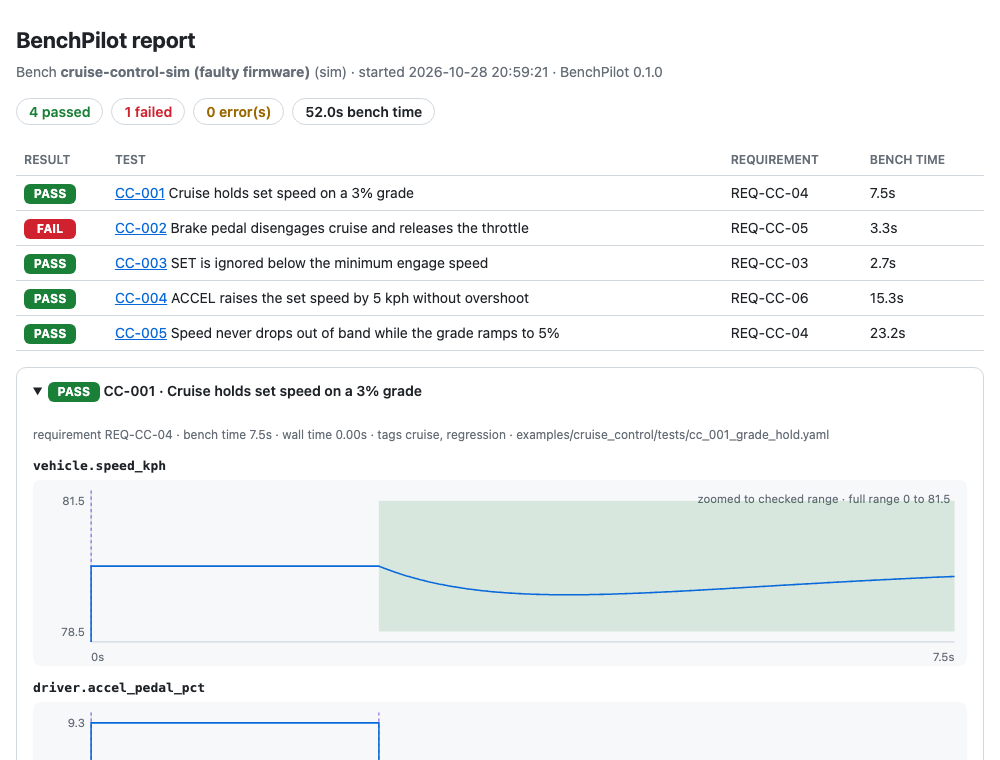

# BenchPilot

Vendor-agnostic hardware-in-the-loop (HIL) testing in Python.


- **Tests as data.** Test cases are YAML that test engineers can read and review without writing Python.
- **Any bench.** The same test runs on the built-in simulator or on a real HIL bench. You swap the adapter in `bench.yaml` and leave the tests alone.
- **Zero hardware to start.** A virtual ECU and vehicle model ship in the box, so you can see tests pass a minute after cloning.
- **Safety interlocks.** Limits in `bench.yaml` block unsafe values before they reach hardware.
- **Proven to catch bugs.** The virtual ECU can run deliberately buggy firmware, and the test suite checks that every injected fault is caught.

> **Status: pre-alpha.** The simulator works end to end. The dSPACE (ASAM XIL) and Lauterbach TRACE32 adapters are **experimental**: they were built from public documentation and tested against fakes, but haven't been validated on hardware.

## Quickstart

Requires Python 3.10 or newer.

**macOS / Linux**

```bash
git clone https://github.com/immanuel-joseph/benchpilot.git && cd benchpilot
python3 -m venv .venv && source .venv/bin/activate
pip install -e .
benchpilot run examples/cruise_control
```

**Windows (PowerShell)**

```powershell
git clone https://github.com/immanuel-joseph/benchpilot.git; cd benchpilot
py -3 -m venv .venv; .venv\Scripts\Activate.ps1
pip install -e .
benchpilot run examples\cruise_control
```

If PowerShell refuses to run `Activate.ps1`, allow local scripts for your user once with `Set-ExecutionPolicy -Scope CurrentUser RemoteSigned`. Or skip activation and call `.venv\Scripts\benchpilot.exe` directly.

All 5 tests pass. On the simulator, time is simulated: 55 s of bench time runs in a few milliseconds.

Now run the same tests against firmware with a bug in it:

```bash
benchpilot run examples/cruise_control --bench examples/cruise_control/faulty.bench.yaml
```

In [`faulty.bench.yaml`](examples/cruise_control/faulty.bench.yaml), the virtual ECU's brake no longer cancels cruise control. CC-002 fails and reports exactly what it saw. Other faults you can inject there:

| Fault | Caught by |
|---|---|
| `no_integral` | CC-005 |
| `low_min_engage` | CC-003 |
| `double_accel_step` | CC-004 |

## A test case

```yaml
id: CC-001
title: Cruise holds set speed on a 3% grade
requirement: REQ-CC-04
tags: [cruise, regression]
setup:
  - set: {signal: vehicle.speed_kph, value: 80}
  - set: {signal: driver.accel_pedal_pct, value: 9.3}
  - set: {signal: cruise.enable, value: 1}
  - wait: 2s
steps:
  - set:  {signal: cruise.set_button, value: 1}
  - wait: 0.5s
  - set:  {signal: cruise.set_button, value: 0}
  - set:  {signal: driver.accel_pedal_pct, value: 0}
  - expect: {ecu_var: cc_state, equals: 2}        # read via the debug adapter
  - set:  {signal: road.grade_pct, value: 3}
  - expect:
      signal: vehicle.speed_kph
      equals: 80
      tolerance: 1.5
      within: 10s       # must enter the band within 10 s...
      hold_for: 5s      # ...and then stay in it for 5 s
teardown:                # always runs, even after a failure
  - set: {signal: cruise.enable, value: 0}
```

| Step | Form | Meaning |
|---|---|---|
| `set` | `{signal: s, value: v}` or `{ecu_var: x, value: v}` | Write a plant signal or an ECU variable |
| `wait` | `2s`, `500ms`, `1.5min` | Let bench time pass |
| `ramp` | `{signal: s, to: v, over: 4s}` (optional `from`) | Linear ramp; both ends are checked against the interlocks before it starts |
| `expect` | `{signal: s, equals: v, tolerance: t}` or `{signal: s, min: a, max: b}` | Check a value. `within` gives it time to get there; `hold_for` requires it to stay there. `{min: 78, hold_for: 15s}` reads as "never drops below 78 for 15 s". |
| `expect_response` | `{signal: s, to: v, tolerance: t, settles_within: 15s, overshoot_max: 2%, rise_time_max: 8s}` | Judge a step response the way control requirements are written: settling time, overshoot, rise time (see below) |

**Step responses.** Put `expect_response` right after the step that causes a change, such as a button press or a new setpoint. It watches the signal move from `from` (read automatically if you leave it out) to `to`, and measures:

| Measure | Meaning | Option |
|---|---|---|
| Settling time | Time until the signal enters `to ± tolerance` and stays there for `hold_for` (default 1 s) | `settles_within: 15s` |
| Overshoot | How far it goes past `to`: `"2%"` means 2% of the step size, a plain number means signal units | `overshoot_max: 2%` or `overshoot_max: 1.5` |
| Rise time | Time from 10% to 90% of the way from `from` to `to` | `rise_time_max: 8s` |

Use any combination. Without `settles_within`, also give `observe: 10s` so it knows how long to watch. A failure reports every measured value, with the failing ones first, for example `overshoot 0.37 (7.3%) (max 2%); settled after 1.07s (max 15s)`. The HTML report shows the measurements in the step table. To check that a signal **never exceeds** a limit over a period, use `expect` with `max` and `hold_for`.

**Outcomes.** A test ends in one of three outcomes:

- **PASS**: every check held.
- **FAIL**: an `expect` didn't hold, so the system under test misbehaved.
- **ERROR**: the test couldn't run properly. The cause is an unknown signal, a blocked unsafe value, an adapter fault, a failed bench reset, or Ctrl+C.

**Teardown.** Teardown runs after every test, pass or fail, and it attempts **every** step even if one of them fails. If an earlier step already failed, that first failure is what the result reports.

**Ctrl+C.** If you interrupt a run, BenchPilot first runs the current test's teardown and stops the capture. It then prints the summary so far, reports `interrupted; teardown ran`, and exits with code 130.

**Bench reset failure.** If resetting the bench between tests fails, that test is recorded as ERROR (`bench reset failed: ...`) and the suite stops, with the summary printed. Results from a bench in an unknown state would be meaningless.

**Numbers must be finite.** Test cases and `bench.yaml` limits reject `.nan` and `.inf` when they're loaded. At runtime, a NaN or infinite reading never satisfies an `expect`, and a non-finite value is never written to the bench or the ECU, whether or not that signal has a limit.

## The bench file

Tests use logical names such as `vehicle.speed_kph`. Each bench's `bench.yaml` maps those names to its own paths and sets the safety limits:

```yaml
name: cruise-control-sim
bench: {adapter: sim, options: {model: cruise_control}}
debug: {adapter: sim}
signals:
  vehicle.speed_kph: plant/speed_kph
  road.grade_pct:    plant/grade_pct
  # ...
limits:                       # plant-side writes, keyed by logical signal name
  road.grade_pct: {min: -12, max: 12}
ecu_limits:                   # ECU variable writes (set: {ecu_var: ...}), keyed by variable name
  cc_state: {min: 0, max: 2}
```

Both kinds of limit are enforced in the session layer, above every adapter, so no adapter can skip them. A blocked write never reaches the bench and makes the test an ERROR.

To move the suite to a real bench, write a new `bench.yaml` that uses that bench's adapter and paths. The tests themselves don't change.

## CLI

```bash
benchpilot run <tests or folders> [--bench bench.yaml] [--tag regression] [--dry-run]
               [--html report.html] [--junit results.xml]
benchpilot validate <tests or folders> [--bench bench.yaml]   # schema + signal-name check
benchpilot check-bench [--bench bench.yaml] [--write SIGNAL=VALUE] [--read-var NAME] [--write-var NAME=VALUE]
```

`run --dry-run` touches nothing. It creates no adapter, so it works even without the vendor software installed. It prints every step of every test with the bench path each write goes to, checks every value against the safety limits, flags unknown signals, and gives an upper bound on bench time. If it finds a problem, it exits with 1.

`check-bench` runs the bench contract. It connects, reads every mapped signal, checks that unknown paths are rejected, that waiting works and that signals can be recorded, then disconnects. It is read-only unless you pass `--write`. Each `--write` value goes through the safety limits, is read back, and the original value is restored afterwards.

`validate` only reads files. With `--bench`, it checks signal names against that file's signal map without creating any adapter, so it never connects to hardware.

If you don't pass `--bench`, the CLI uses the nearest `bench.yaml` at or above the test path.

| Exit code | Meaning |
|---|---|
| `0` | All tests passed |
| `1` | At least one test failed or errored |
| `2` | Usage or configuration error |
| `130` | Interrupted with Ctrl+C (teardown ran) |

## Reports

```bash
benchpilot run examples/cruise_control --html reports/run.html --junit reports/results.xml
```

`--html` writes a single self-contained page: no scripts, no external files, so it opens offline and can be emailed.

- **A summary table** at the top, with failed tests expanded and passed ones collapsed.
- **A plot per recorded signal** for each test:
  - Every `expect` is drawn as a band over the time it was checked: **green** if it held, **red** if it didn't.
  - Every write is drawn as a dashed marker.
  - When a signal's full range would hide the checked band, the plot zooms to the band and says so.
- **ECU variables** checked with `expect` get their own plot of the readings taken.
- **A step table** with the timing and result of every step.



`--junit` writes standard JUnit XML that CI systems and test dashboards read. Each test case includes its requirement and tags. The file deliberately leaves out the machine's hostname.

Both reports are written even when a run is interrupted with Ctrl+C, covering the tests that finished.

## Real benches: dSPACE via ASAM XIL (experimental)

The `xil` adapter drives a HIL bench through the ASAM XIL API. It's written for dSPACE first, and runs on Windows with `pip install -e ".[xil]"`:

```yaml
bench:
  adapter: xil
  options: {product_version: "2023-B", maport_config: C:/benches/rig1/MAPortConfig.xml}
signals:
  vehicle.speed_kph: "Model Root/Plant/Vehicle/Speed/Value"
```

It was written from the public XIL API documentation and tested against an in-memory fake with the same interface (`backend: fake`). It hasn't been validated on physical hardware. **[docs/dspace.md](docs/dspace.md)** walks through setup, step by step, starting with a read-only `check-bench`.

## ECU internals: Lauterbach TRACE32 (experimental)

The `trace32` debug adapter reads and writes variables inside the ECU through a Lauterbach debugger. Those are `ecu_var` steps, and every write is checked against `ecu_limits`. It works alongside any bench adapter, so a dSPACE HIL can drive the ECU from outside while TRACE32 looks inside. Install it with `pip install -e ".[trace32]"`.

```yaml
debug:
  adapter: trace32
  options: {node: localhost, port: 20000}
```

`check-bench` covers the debugger too. `--read-var` reads variables, and `--write-var NAME=VALUE` writes one, reads it back and restores it. ECU resets between tests are opt-in (`reset_commands`). Like the XIL adapter, it was written from public documentation and tested against a fake; it hasn't been validated on hardware. **[docs/trace32.md](docs/trace32.md)** has the setup.

## Writing an adapter

An adapter implements two small interfaces from `benchpilot.core.interfaces`:

- **`BenchAdapter`** drives the plant side: `connect`, `set`, `get`, `start_capture`, `stop_capture`, `disconnect`. It can optionally override the time hooks `time` and `wait` (simulators step instead of sleeping) and `reset`.
- **`DebugAdapter`** reaches into the ECU: `read_var`, `write_var`, `reset_target`.

Register the adapter's factory through an entry point in your own package. It then becomes available in `bench.yaml` with no changes to the core:

```toml
[project.entry-points."benchpilot.bench_adapters"]
mybench = "my_package.adapter:create_bench"     # (options: dict) -> BenchAdapter

[project.entry-points."benchpilot.debug_adapters"]
mydebugger = "my_package.adapter:create_debugger"  # (options: dict, bench) -> DebugAdapter
```

Vendor adapters call the vendor's own installed library at runtime. No vendor SDK code is bundled in this repository.

## Scope

BenchPilot automates tests on top of your vendor tools; it doesn't replace them, ship their libraries, or certify functional-safety compliance.

## Development

```bash
uv venv && uv pip install -e ".[dev]"
git config core.hooksPath .githooks   # run CI before every push
scripts/ci.sh                         # lint, tests on Python 3.10 + 3.12, package and privacy checks
```

[CONTRIBUTING.md](CONTRIBUTING.md) covers the branch workflow and what CI checks. After changing CLI output, regenerate the README demo with `.venv/bin/python scripts/render_demo.py`.

## License

Apache License 2.0. See [LICENSE](LICENSE).
